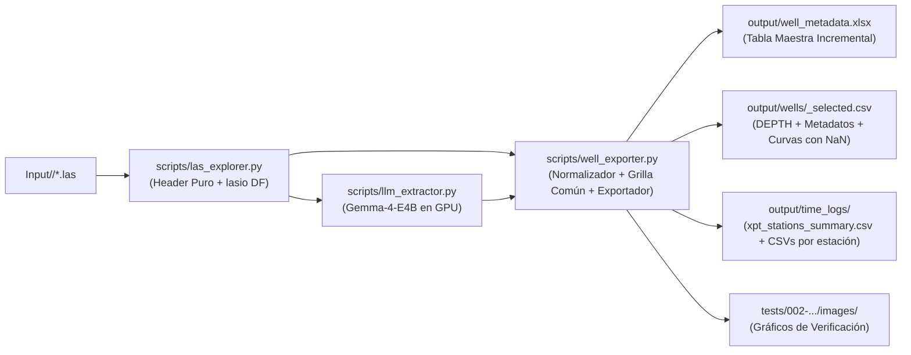

# Plan de Implementación — Spec 002: Exportación a `output/` y Grilla Común

## 1. Arquitectura de Módulos

## 2. Decisiones Técnicas

1. **Normalización determinística post-LLM (`normalize_well_metadata`)**:
   - Además de ajustar el `SYSTEM_PROMPT` de `llm_extractor.py` para que sepa que `X` es Este (`~2.481.xxx`) e `Y` es Norte (`~4.834.xxx`), `well_exporter.py` aplica una validación geométrica: si `coord_x > 3_500_000` y `coord_y < 3_500_000`, los intercambia automáticamente.
   - Redondea `X` e `Y` a enteros (`int(round(...))`) y `Elevation` (`COTA`) a 2 decimales (`round(cota, 2)`), tal como en las tablas de referencia del usuario.
   - Si el `UWI` comienza con `AR01` y tiene longitud 12, le concatena `"00"` para llevarlo a 14 caracteres.
   - Normaliza el nombre del pozo eliminando puntos sueltos antes de `a-` o `-` (`YPF.SC.CV.a-38` -> `YPF.SC.CVa-38`).

2. **Cálculo del Paso Efectivo y Grilla Común (`build_unified_depth_dataframe`)**:
   - En cada `.LAS` de profundidad, se ordena el DataFrame por la columna de profundidad ascendente y se eliminan filas con profundidad nula o duplicada.
   - Si `summary.step <= 0`, se calcula `effective_step = round(float(np.median(np.diff(valid_depths))), 4)`.
   - `grid_step = min(effective_steps)` entre todos los `.LAS` de profundidad del pozo.
   - `grid_start = round(min(min_depths), 4)` y `grid_stop = round(max(max_depths), 4)`.
   - Se genera el vector `grid_depths = np.round(np.arange(grid_start, grid_stop + grid_step * 0.5, grid_step), 4)`.
   - Para cada curva:
     - Si las profundidades válidas coinciden con la grilla dentro de `1e-3 m`, o al interpolar con `np.interp`, solo se asignan valores dentro de `[valid_min_depth, valid_max_depth]`.
     - Si existen saltos internos de datos faltantes mayores a `2.5 * effective_step` entre dos muestras válidas consecutivas de esa curva, los puntos de la grilla dentro de esa brecha se mantienen como `np.nan`.

3. **Actualización Incremental de `output/well_metadata.xlsx` (`update_master_excel`)**:
   - Si `output/well_metadata.xlsx` existe, se lee con `pd.read_excel`, se reemplaza la fila si el pozo (`Well`) ya estaba o se agrega si es nuevo, se recalculan todas las columnas de curvas en orden alfabético (rellenando con `"no"` las curvas que no apliquen a pozos anteriores) y se guarda con formato limpio usando `openpyxl`.
