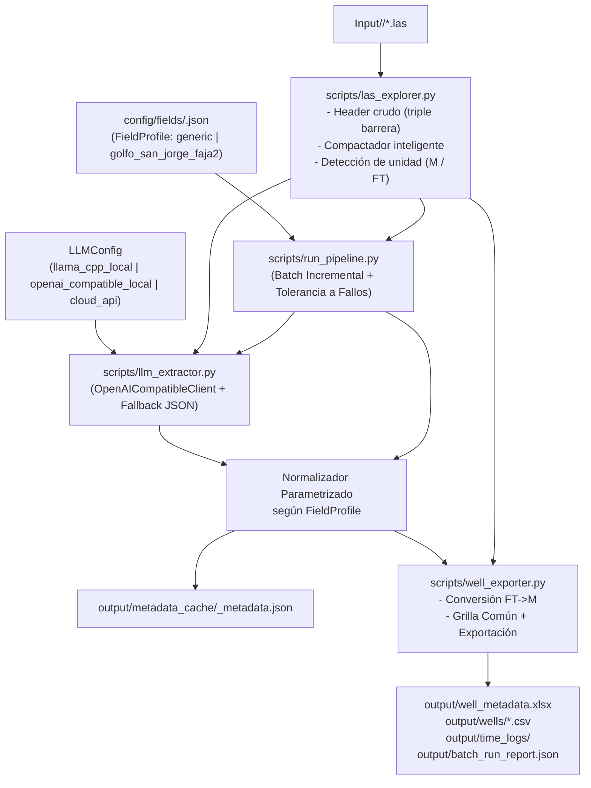

# Plan Técnico — Spec 003: Escalabilidad Multi-Campo, Multi-Modelo y Batch

## 1. Arquitectura Desacoplada Propuesta

## 2. Decisiones de Diseño por Módulo

### 2.1 `scripts/field_profiles.py` + `config/fields/`
- Dataclass `FieldProfile` cargable desde JSON (`generic.json` por defecto cuando no se especifica yacimiento, y `golfo_san_jorge_faja2.json` para los pozos de Cañadón Vasco / Santa Cruz).
- Campos clave del perfil:
  - `profile_name`: identificador legible.
  - `target_depth_unit`: `"M"` (por defecto).
  - `coord_x_range` / `coord_y_range`: tuplas `[min, max]` opcionales (`null` en `generic`). Solo si ambas están definidas y el par `(X, Y)` coincide exactamente al revés con los rangos esperados, se ejecuta el intercambio automático.
  - `coord_decimals`: `int | None` (`null` en `generic` para conservar grados decimales o decimales métricos; `0` en `golfo_san_jorge_faja2`).
  - `uwi_pad_rules`: lista opcional de reglas regex -> sufijo/formato (`[]` en `generic`).
  - `well_name_regex_replacements`: lista de pares `[pattern, replacement]`.
  - `prompt_domain_hints`: texto de ayuda contextual opcional para el prompt del LLM.
  - `pressure_summary_mnemonics`: mnemónicos de presión/temperatura para resumir registros en tiempo (`TIME`).

### 2.2 `scripts/llm_extractor.py`
- Separar `LLMConfig` (dataclass con `provider`, `base_url`, `api_key_env`, `model_name`, `model_path`, `server_bin`, `gpu_device`, `ctx_size`, `max_tokens`, `timeout_s`, `temperature`) y `OpenAICompatibleLLMClient`.
- `LocalLlamaServer` pasa a ser únicamente el administrador opcional del proceso `llama-server.exe` cuando `provider == "llama_cpp_local"`, exponiendo su `base_url` al mismo `OpenAICompatibleLLMClient`.
- Prompt base (`build_system_prompt(field_profile)`) sin menciones geográficas hardcodeadas; si `field_profile.prompt_domain_hints` tiene texto, se anexa como sección adicional.
- Cadena de resiliencia en `extract_well_metadata`:
  1. Intenta `/v1/chat/completions` con `json_schema` estricto.
  2. Si recibe HTTP 400/422 o error de parámetro no soportado, reintenta automáticamente con `response_format: {"type": "json_object"}` (y si tampoco se soporta, sin `response_format` reforzando la instrucción JSON en el mensaje).
  3. Valida tipos mínimos (`nombre_pozo` string no vacío, `curvas_detectadas` lista); si el parseo JSON falla, ejecuta hasta 1 reintento con feedback del error de parseo.

### 2.3 `scripts/las_explorer.py` y `scripts/well_exporter.py`
- **Conversión `FT → M`**: en `parse_single_las` o antes de unificar en `well_exporter.py`, identificar `index_unit` (`FT`, `F`, `FEET`) y escalar índice, `declared_start`, `declared_stop`, `step` y `stationary_depth_m` por `0.3048` cuando `target_depth_unit == "M"`, registrando `original_index_unit` en `LasFileSummary` para trazabilidad.
- **Compactación inteligente**: en `_compact_raw_header_for_llm`, omitir líneas cuyo campo de valor antes de `:` esté vacío fuera de `~Curve` (ej. `R14 . :Remark Line 14`, `STAT . :`), conservando siempre todas las líneas de `~Version`, `~Well`, `~Curve` y `~Parameter` con contenido útil.

### 2.4 `scripts/run_pipeline.py`
- CLI con `argparse`:
  - `--input`, `--output`, `--field-profile` (`generic` o ruta/nombre en `config/fields/`),
  - `--provider` (`llama_cpp_local`, `openai_compatible_local`, `cloud_api`), `--model`, `--base-url`, `--api-key-env`,
  - `--repeat-strategy` (`keep_all` | `merge`), `--incremental` (saltea pozos ya exportados), `--use-cache` / `--clean`.
- Escritura de `output/batch_errors.log` y `output/batch_run_report.json` por cada corrida.
