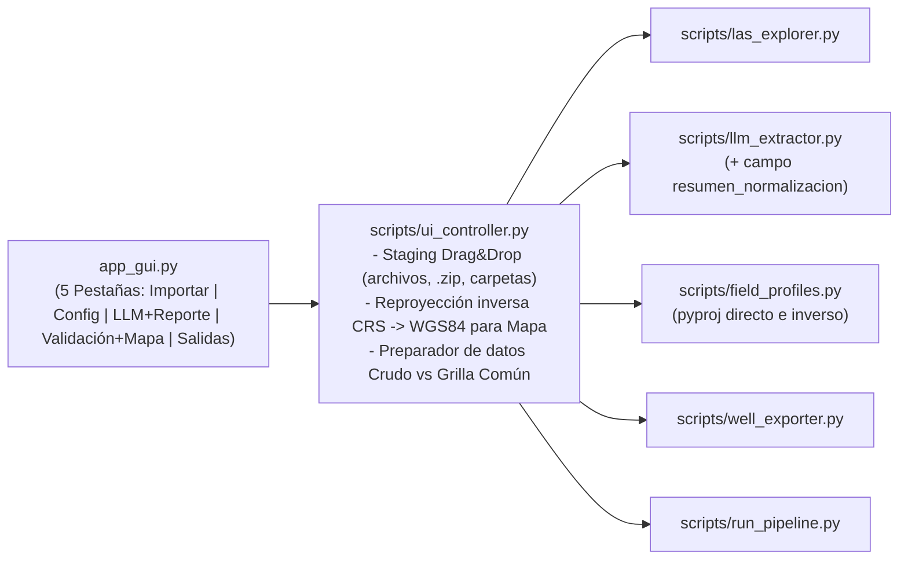

# Plan Técnico — Spec 004: Interfaz Gráfica Well Curator

## 1. Comparativa de Arquitectura UI (Ambas ya instaladas en Python 3.14)

> **Decisión pendiente de confirmación del usuario antes de implementar código:**

| Criterio | Opción A: **Escritorio Nativa (`PySide6` / Qt6)** | Opción B: **Web Local (`Streamlit` + `Plotly` + `Folium`)** |
| :--- | :--- | :--- |
| **Estética comercial** | Aspecto clásico-moderno de software de ingeniería de escritorio (ventana nativa, barras, pestañas Qt, tema claro/oscuro tipo Petrel/QGIS). | Aspecto dashboard web moderno en navegador local (tabs limpios, widgets ágiles). |
| **Drag & Drop de carpetas** | **Nativo total desde Windows Explorer**: acepta soltar **carpetas completas**, múltiples `.las` sueltos y `.zip` sin restricciones del navegador. | Acepta arrastrar múltiples `.las` sueltos y `.zip`; para **carpetas enteras** el navegador tiene restricciones y suele requerir selector de ruta / diálogo de sistema. |
| **Mapas y gráficos de logs** | `matplotlib` embebido en Qt + `plotly`/`folium` en `QWebEngineView` (o mapas estáticos/interactivos). | `plotly` (tracks de curvas con zoom nativo instantáneo) + `folium` (mapa satelital/OSM con 10 líneas) + tablas `st.data_editor`. |
| **Velocidad de iteración** | Media (código de señales/slots, QThreads, layouts). | Muy rápida y mantenible, ideal para inspección tabular y gráficos interactivos. |

---

## 2. Arquitectura Modular Desacoplada (Backend de UI reutilizable)

Independientemente de si la capa visual final usa `PySide6` o `Streamlit`, toda la lógica de negocio de la UI vivirá separada en un controlador limpio:

### Componentes nuevos / extendidos planificados:
1. **`scripts/llm_extractor.py`**:
   - Añadir campo `"resumen_normalizacion": {"type": "string"}` en `METADATA_JSON_SCHEMA` y en `BASE_SYSTEM_PROMPT` para que el LLM redacte un informe claro por pozo explicando qué conflictos resolvió, de dónde tomó coordenadas/cota y qué curvas detectó.
2. **`scripts/ui_controller.py`** (desacoplado de la vista, 100% testeable con `pytest`):
   - `stage_uploaded_inputs(...)`: recibe archivos sueltos, un `.zip` o una carpeta completa y prepara un directorio de trabajo seguro por pozo sin tocar `Input/`.
   - `preview_staged_wells(...)`: escaneo rápido con `las_explorer` sin invocar LLM (clasificación `DEPTH` vs `TIME`, `M` vs `FT`, curvas repetidas).
   - `compute_wgs84_map_points(...)`: usa `pyproj` inverso (`crs_used` -> `EPSG:4326`) para obtener `(lat, lon)` exactos de cada pozo curado y alimentar el mapa geográfico.
   - `prepare_log_comparison_series(...)`: lee curva original `.las` y columna equivalente del CSV unificado para graficado interactivo Crudo vs Grilla Común.
3. **`scripts/app_gui.py`**:
   - Implementación de las 5 pestañas en el framework elegido por el usuario.
