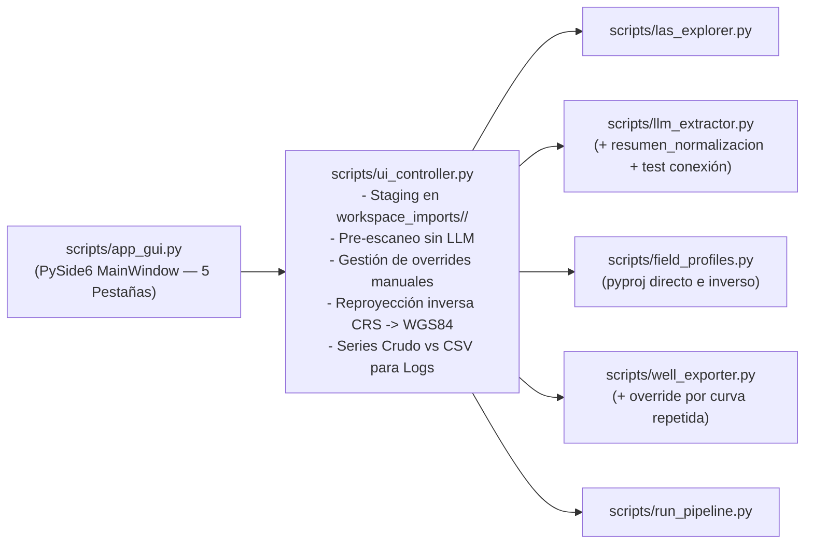

# Plan Técnico — Spec 004: Interfaz Gráfica PySide6 (Qt6)

## 1. Stack Gráfico Confirmado (Cero Dependencias Nuevas)
- **Framework de UI**: **`PySide6` (Qt6)** con tema comercial clásico-moderno (`Fusion` + QSS limpio estilo software técnico petrolero: barra lateral/superior de estado, 5 pestañas secuenciales, tablas `QTableWidget`, consola de logs en vivo y barra de progreso).
- **Drag & Drop Nativo (`QWidget.setAcceptDrops(True)`)**: acepta soltar directamente desde Windows Explorer **carpetas completas**, **archivos `.las`/`.LAS` sueltos** y **archivos `.zip`**, alojándolos en `workspace_imports/<Pozo>/` sin tocar jamás `Input/`.
- **Visor de Registros (Logs) y Validación**: `matplotlib` embebido en Qt mediante `FigureCanvasQTAgg` + `NavigationToolbar2QT` (zoom, pan y exportación de imagen para hasta 6 tracks paralelos por pozo, Gantt de cobertura, matriz `yes`/`no` y estaciones `XPT`).
- **Mapa Geográfico Interactivo**: `folium` + `pyproj` (reproyección inversa `EPSG` → `EPSG:4326`) renderizado dentro de la pestaña con `PySide6.QtWebEngineWidgets.QWebEngineView` (con fallback automático a mapa en planta `matplotlib` si no hay conexión a internet para tiles).
- **Concurrencia sin bloqueo**: `QThread` / `QThreadPool` dedicado para pre-escaneo, inferencia LLM y exportación hacia `output/`.

---

## 2. Arquitectura Modular Desacoplada

### Componentes clave a construir/extender:
1. **`scripts/llm_extractor.py`**:
   - Añadir `"resumen_normalizacion": {"type": "string"}` en `METADATA_JSON_SCHEMA` y `BASE_SYSTEM_PROMPT` para que el LLM explique en lenguaje natural qué conflictos resolvió, qué archivos leyó, cómo obtuvo X/Y/Cota y qué curvas repetidas o en tiempo detectó.
   - Añadir helper `test_llm_connection(config)` (verifica `/health` o `/v1/models`) para el botón *"Probar conexión"* en la UI.
2. **`scripts/ui_controller.py`** (100% desacoplado de Qt para ser testeable con `pytest`):
   - `stage_well_drop_items(paths, target_well_name, workspace_imports_dir)`: procesa carpetas, archivos `.las` sueltos o `.zip` hacia `workspace_imports/<Pozo>/`.
   - `discover_well_sources(root_dirs)`: lista pozos disponibles tanto de `Input/` (solo lectura) como de `workspace_imports/` y carpetas batch elegidas por el usuario.
   - `inverse_project_to_wgs84(x, y, crs_used)`: convierte cualquier coordenada curada (`EPSG:5343..5349` o UTM) a `(lat, lon)` WGS84 usando `pyproj`.
   - `build_folium_well_map_html(wells_map_data)`: genera el HTML interactivo con marcadores diferenciados (GK directa vs proyectada Lat/Lon) y popups comparando nombre original vs normalizado.
   - `prepare_well_log_tracks(...)`: prepara las series originales `.las` vs CSV unificado para hasta 6 tracks paralelos.
3. **`scripts/well_exporter.py`**:
   - Añadir soporte opcional `per_curve_overrides` (para permitir en la UI elegir qué curvas repetidas conservar con `:2`, `:3` o fusionar en el pozo antes de exportar).
4. **`scripts/app_gui.py`**:
   - Ventana principal Qt6 con las 5 pestañas, ejecutable con `python scripts/app_gui.py`.
